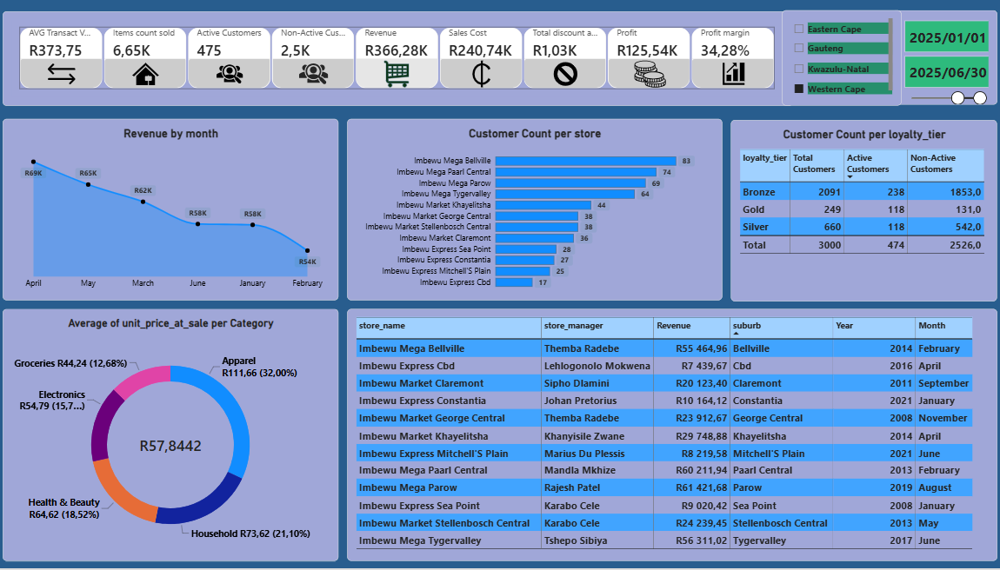
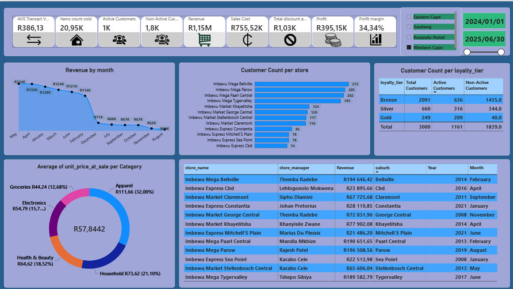

# Imbewu Retail-Sales Analysis

End-to-end retail sales analysis project developed as part of the Data Analytics Bootcamp student assessment. Formulated business hypotheses to investigate Western Cape decline in revenue yet customers were still coming through the door, used Databricks SQL to clean and transform messy datasets using CTEs and conduct SQL-based investigations, and independently used Power Query to perform data cleaning in Power BI. Developed DAX measures and interactive dashboards to explore revenue trends, store performance, and customer insights across an 18-month period.


### Dashboard Overview

The analysis covers 18 months of data, presented through four visualisations. The first three visualisations break the data into separate six-month periods to make it easier to examine sales performance over time. The fourth visualisation brings all 18 months together, providing an overall view of business performance and helping identify broader trends.






📌[Table of Contents](#imbewu-retail-sales-analysis)
- The problem
  
- What I built
  
- Tools & skills used
  
- The dataset
  
- Data quality issues
  
- How to run this project
  
- Project structure
  
- Data model
  
- Dashboards
  
- Key findings and recommendations
  
- What I learned
  
- References
  
- About me

- Contributors

 ## 🎯The problem
 Imbewu Retail is a fictional South African retail business operating across Gauteng, Western Cape, KwaZulu-Natal and Eastern Cape. The head of sales was worried about the latest revenue report and something's off in Western Cape.Numbers were down compared to last year, but the store visit reports say foot traffic is 
roughly flat and this didn't add up. The head of sales didn't want PowerPoint slides, instead she wanted one Power BI dashboard she could actually use, plus a short written summary she could forward to the COO. 

## 🛠️What I build
1. Designed a galaxy schema with two facts table and four dimensions, optimised for analytical queries and Power BI performance.

2. Performed data quality checks to identify missing values, inconsistent formatting, whitespace issues and data type inconsistencies. Applied cleaning and transformation techniques using Databricks SQL CTEs and Power Query to improve data consistency and reliability for analysis.

3. Wrote 6 analytical SQL queries covering revenue, store level performance, customer count, and discount impact.

4. Built a Power BI dashboard — segmented into 6 months periods and overview of the whole 18 months period for Western Cape — driven by a number of DAX measures.

## 💻Tools and skills used

### Tools
- Power BI Desktop

- DAX

- Databrick

- Git and GitHub

### Skills
Dimensional modelling (galaxy schema design)

SQL — CTEs, window functions, ranking, time intelligence

DAX — time intelligence, ranking, customer cohort logic

Data validation and reconciliation

Data quality auditing and remediation

Dashboard design — KPI hierarchy, audience-led layout, colour discipline

Technical writing and documentation

## 📦The dataset
The full dataset lives in data folder as six CSV files. It's fully synthetic — no real customer or sales data is included — but it's been generated to look and behave like a real retail dataset and for learning purposes.

3.1 Customers Table

| Column       | Description                            |
| ------------ | -------------------------------------- |
| customer_id  | Unique identifier for each customer.   |
| birth_year   | Customer's year of birth.              |
| gender       | Customer's recorded gender.            |
| first_name   | Customer's first name.                 |
| last_name    | Customer's last name.                  |
| loyalty_tier | Customer's loyalty programme category. |
| home_suburb  | Suburb where the customer lives.       |
| signup_date  | Date the customer joined the business. |

3.2 Stores Table

| Column        | Description                          |
| ------------- | ------------------------------------ |
| store_id      | Unique identifier for each store.    |
| store_name    | Name of the store.                   |
| store_manager | Manager assigned to the store.       |
| format        | Store format or type.                |
| province      | Province where the store is located. |
| city          | City where the store is located.     |
| suburb        | Suburb where the store is located.   |
| opened_date   | Date the store was opened.               |

3.3 Transactions Table

| Column           | Description                                             |
| ---------------- | ------------------------------------------------------- |
| transaction_id   | Unique identifier for each transaction.                 |
| customer_id      | Identifier of the customer who made the transaction.    |
| store_id         | Identifier of the store where the transaction occurred. |
| transaction_date | Date and time of the transaction.                       |
| payment_method   | Method used to pay for the transaction.                 |

3.4 Transaction Items Table

| Column             | Description                                     |
| ------------------ | ----------------------------------------------- |
| Item_id            | unique identifier for each transaction_item     |
| transaction_id     | Identifier linking an item to a transaction.    |
| product_id         | Identifier of the product purchased.            |
| quantity           | Number of units purchased.                      |
| unit_price_at_sale | Selling price per unit at the time of purchase. |
| discount_applied   | Discount applied to the item.                   |

3.5 Products Table

| Column       | Description                               |
| ------------ | ----------------------------------------- |
| product_id   | Unique identifier for each product.       |
| product_name | Name of the product.                      |
| category     | Product category.                         |
| Sub_category | Specific classification of the product    |
| Brand        | Brand of the product                      |
| unit_price   | Current listed selling price per unit.    |
| unit_cost    | Cost of purchasing or producing one unit. |


3.6 Promotions

|column              | Description                           |
|--------------------|---------------------------------------|
| promo_id           | Unique identifier for each promotion  |
| promo_name         | Name of the promotion                 |
| category_targeted  | category the promotion is aimed at    |
| start_date         | start_date of the promotion           |
| end_date           | end_date of the promotion             |
| discount_ptc       | discount allowed on promotions        |

Key dataset characteristics:

- 18 months of history, weighted to show realistic year-on-year growth (2022 → 2024)
  
- Strong December seasonality and softer Jan/Feb periods
  
- Groceries is the dominant category by revenue
  
- Apparels is the dominant category by unit pice

- Loyalty tier distribution skews Bronze (most customers) with a small gold elite

You can analyse the CSVs directly in Excel, Python, or any BI tool. The SQL scripts in the repository contain the data-cleaning, transformation and queries developed in Databricks SQL. The original datasets were also independently imported into Power BI, where Power Query was used to perform similar cleaning and transformation processes, followed by data modelling, DAX calculations and dashboard development.

## ⚠️Data quality issues

This dataset is intentionally messy in the same ways real retail data is messy. Part of this project's value is showing how to find, document, and handle these issues before they reach a dashboard.


|          Issue              |                                                                      
| --------------------------- | 
| Unnecessary whitespace      | 
| Inconsistent capitalisation | 
| Missing values              | 
| Inconsistent data types     | 
| Missing customer IDs        | 
| Missing store managers      | 

Every issue is documented in docs/data-quality.md folder with:

- The SQL query to find it
  
- The decision on how to handle it (fix at source / fix in pipeline / flag and live with it)
  
- The downstream impact

## ⚙️How to run this project

### Quick exploration (CSVs only)
If you just want to look at the data, the CSV files in data folder, open directly in Excel, Power BI, Python, or any SQL tool that supports CSV import. No database setup required.

## How to Open the Power BI Report

**Step 1 — Download the Power BI report**

1. Navigate to the project repository on GitHub.
 
2. Locate the `.pbix` file.
 
3. Click **Download** to save the file to your computer.

**Step 2 — Open the Power BI report**

1. Install and open Power BI Desktop.
 
2. Open the downloaded `.pbix` file.
 
3. Explore the interactive dashboards using the available filters and visualisations.

**Note on the `.pbix` file:** The Power BI file is a binary file and cannot be viewed directly on GitHub. Download it and open it using Power BI Desktop to explore the interactive report. The dashboard screenshots in this README provide a visual preview of the report.

## 📁Project Structure
```
Imbewu-retail-sales-analysis/
├── README.md                             ← You are here
├── LICENSE
├── .gitignore
│
├── data/
│   ├── dim_promotions.csv                ← Promotion dimension (4 rows)
│   ├── dim_products.csv                  ← Product dimension (48 rows)
│   ├── dim_stores.csv                    ← Store dimension (45 rows)
│   ├── dim_customers.csv                 ← Customer dimension (3000 rows
│   ├── fact_transactions.csv             ← Transaction fact table (9164 rows)
│   ├── fact_transaction_items.csv        ← Transaction_item fact (48641)
│   └── README.md                         ← Notes on the dataset
│
├── sql/
│   ├── 01_investigation.sql              ← Investigation 1: Average Transaction Value
│   ├── 02_investigation.sql              ← Investigation 2: Unit Cost And Revenue Analysis
│   ├── 03_investigation.sql              ← Investigation 3: Store Performance And Customer Analysis
│   ├── 04_investigation.sql              ← Investigation 4: Store Revenue Performance Analysis
│   ├── 05_investigation.sql              ← Investigation 5: Average Unit Selling Price Analysis
│   └── 06_investigation.sql              ← Investigation 6: Customer Loyalty, Suburb And Revenue Analysis
│ 
│
├── powerbi/
│   ├── Imbewu_retail_dashboard.pbix      ← Power BI report file
│   ├── dax_measures.md                   ← DAX measures documented
│   └── README.md                         ← How to open the .pbix file
│
├── images/
│   ├── ERD_diagram.png                   ← Galaxy schema diagram
│   ├── ImbewuDashboardJul-Dec2024.png    ← Western Cape Jul-Dec 2024 dashboard screenshot
│   ├── ImbewuDashboard18months.png       ← Western Cape 18 months(Jan 2024-Jun 2025) dashboard screenshot
│   ├── ImbewuDashboard_jan-jun2024.png   ← Western Cape Jan-Jun 2024 dashboard screenshot
│   └── ImbewuDashboardjan-jun2025.png    ← Western Cape Jan-Jun 2025 dashboard screenshot
│
└── docs/
    ├── business-questions.md             ← Business questions
    ├── data-dictionary.md                ← Tables and columns documented
    ├── data-quality.md                   ← Data quality issues and decisions
    └── methodology.md                    ← How I built the project
```

## 🗂️Data Model


### Why galaxy schema?

To model and analyze different business areas
You can run complex, enterprise-level queries 

Full details in docs/data-methodology.md folder.

## 📊Dashboards
Built for Head of sales and COO. Top-line KPIs, monthly trend, and breakdowns by customer count and category.


### Designed to answer
- Customer count per store

- which store is generating more revenue

- Active customer count per loyalty tier

- Most expensive vs least expensive category revenue performance

- was the discount allowed effective and necessary

## 🔍Key finding and Recommendations

### Executive overview. 
The dashboard shows that the business remained profitable, but revenue and customer activity weakened in the first half of 2025. The main opportunity is to reactivate inactive customers, especially within the Bronze loyalty tier, while improving lower-performing stores and protecting
the current profit margin.

### Key Findings
- Revenue declined in the first half of 2025
Revenue decreased from R388.79K in January to June 2024 to R366.28K in January to June 2025. This
represents a decline of approximately R22.51K, or 5.8%, which means the business generated less
income than in the comparable six-month period.

- Profit decreased, but the business remained profitable
Profit fell from R133.58K in January to June 2024 to R125.54K in January to June 2025, a decline of
approximately 6%. However, the profit margin remained stable, moving only slightly from 34.36% to
34.28%. This suggests that the immediate challenge is sales growth rather than a major loss of profitability.

- The high number of inactive customers is a major concern
For January to June 2025, the dashboard shows 475 active customers and approximately 2,500 non-active
customers. The loyalty table also shows 1,853 inactive Bronze customers compared with only 238 active
Bronze customers. This creates a significant opportunity to win back customers who are already known to
the business.
- Bronze is the largest loyalty tier, but customer engagement is weak
Bronze includes 2,091 of the 3,000 customers, which is almost 70% of the customer base. Despite its size,
only 238 Bronze customers were active in January to June 2025. The largest customer group is therefore
not contributing as strongly as it could.

- Revenue is concentrated among the larger stores
In the 18-month dashboard, Imbewu Mega Parow generated R196,508.56, Imbewu Mega Bellville
generated R194,646.42, Imbewu Mega Paarl Central generated R190,651.65, and Imbewu Mega
Tygervalley generated R189,582.79. These stores substantially outperformed several Express locations,
showing that the business relies heavily on its larger stores.

### Recommendations

- Launch a targeted customer reactivation campaign focus on inactive customers, particularly the 1,853 inactive Bronze customers shown for January to June
2025. Use personalised loyalty offers, limited-period promotions, and a next-purchase incentive to
encourage customers to return.

- Strengthen the Bronze loyalty offering because Bronze represents almost 70% of the customer base, improving engagement in this tier can
materially increase sales. Introduce simple incentives that reward repeat purchases and give Bronze
customers a clear path towards Silver or Gold status.

- Investigate the reason for the revenue decline, analyse the approximately 5.8% year-on-year revenue decline by store, product category, month,
customer activity, and purchase frequency. This will help management identify whether the decrease was
driven by fewer active customers, weaker store performance, lower buying frequency, or a combination of
factors.

- Use high-performing stores as internal benchmarks Compare lower-revenue locations with Imbewu Mega Parow, Bellville, Paarl Central, and Tygervalley.
Review differences in product mix, customer activity, transaction patterns, and local promotions, then apply
suitable practices at weaker stores.

- Grow sales while protecting the profit margin, The margin stayed close to 34% in both January to June periods. Management should therefore avoid
broad discounting and instead use targeted promotions, loyalty campaigns, and customer reactivation
initiatives that increase transaction volume without unnecessarily reducing margin.

## 📚What I learned
- Galaxy schema allows in depth modeling and analyzing of different business areas.

- The importance of data modeling and ERD diagram before any analysis

- Documentation of data quality decisions

- The importance of understanding a business requirement before doing analysis

- The importance of having few hyphothesis and building queries around instead of having many saves time and give an analyst a clear direction.

## 📖References
- Microsoft Learn: DAX function reference
  
- Microsoft Learn: Power BI guidance and best practices
  
- Databricks: SQL

The Imbewu Retail dataset is fictional. All customer, Transactions, and store data was synthetically generated for this project. No real personal data is included.

## 👤About Me
I'm an aspiring data analyst building portfolio projects in SQL, Power BI, and Excel.

💼 LinkedIn: Kgopotso Maphisa

📧 Email: maphisako@gmail.com

## 👤Contributors
Project collaboration and contributions to the analysis and development process.
💼 LinkedIn: Mathabo Mokoena

📧 Email: mathabo.mokoena@kpmg.co.za

If you found this project useful, give it a ⭐ on GitHub


